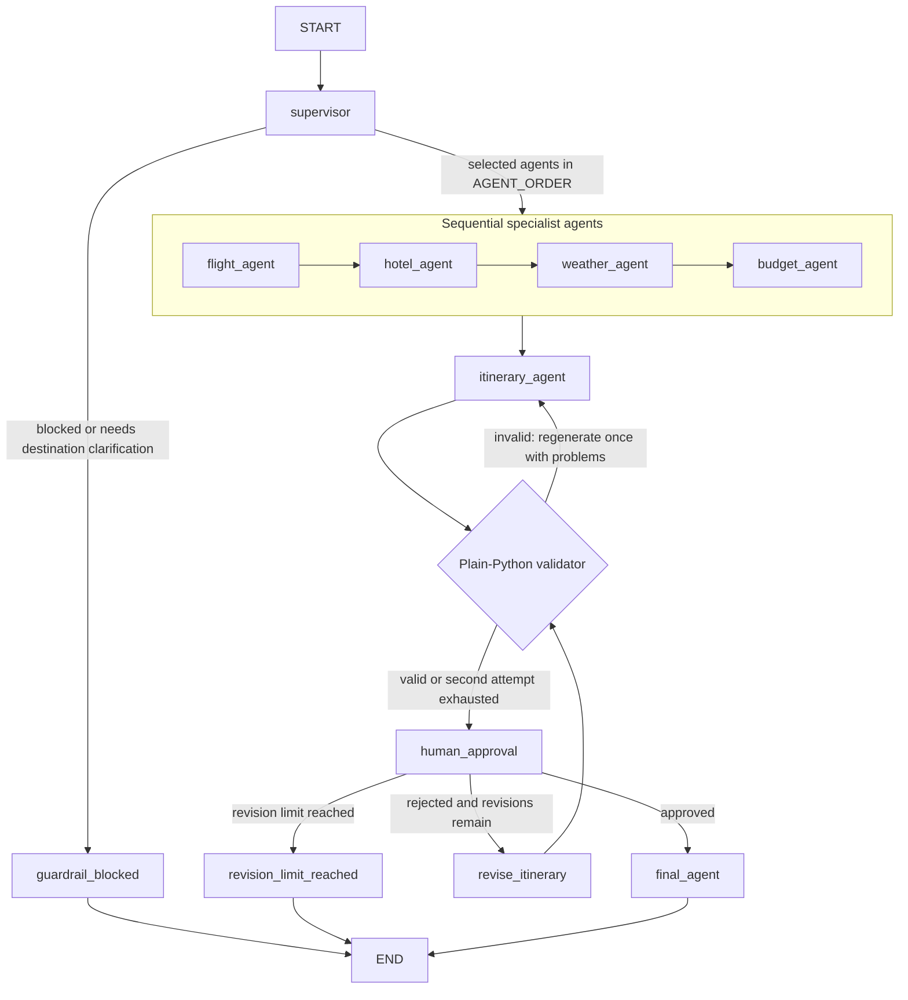

# TripMate AI

TripMate AI is a synchronous FastAPI travel planner powered by LangGraph. A
structured supervisor screens requests and selects specialist agents for live
hotel and weather information, resolves airport codes, and creates a
budget-aware itinerary. Flight fares, schedules, and airlines are reported only
when live flight data is available; otherwise the planner states that they are
unavailable.
The graph pauses for human review, supports bounded revisions, and persists
thread state with `PostgresSaver`.

When the user does not specify a boarding city, TripMate defaults to Delhi
(DEL). For destinations with a valid airport, the flight agent can display
airline names and flight numbers returned by the AviationStack live-status
lookup. These are current status records, not future schedules or fare quotes.

## Project layout

```text
backend/
  app.py                         FastAPI app and API endpoints
  graph.py                       LangGraph state, agents, routing, and results
  auth.py                        Passwords, JWT cookies, sessions, and CSRF
  auth_routes.py                 Signup, login, profile, and preferences
  trip_routes.py                 User-owned travel history API
  trip_service.py                Trip ownership and persistence helpers
  models.py                      SQLAlchemy tables and relationships
  schemas.py                     LangGraph structured-output schemas
  schemas_auth.py                API request and response schemas
  database.py                    SQLAlchemy engine and session dependency
  mcp_client.py                  Tavily, AviationStack, and weather clients
  custom_weather_mcp_server.py   Weather MCP server
  tools/                         Flight-specific helper
  migrations/                    Alembic migration scripts
  evaluations/                   Offline and live workflow evaluation
  scripts/                       Optional MCP diagnostics
tests/                           Pytest tests (kept separate from app code)
frontend/                        React + Vite application
app.py                           Root launcher kept for convenience
```

The graph implementation remains in one module because its nodes and shared
helpers use common state and routing. HTTP endpoints, authentication,
persistence, schemas, integrations, and tests are kept in separate modules
and folders.

## Architecture



The specialist route skips agents the supervisor did not select; selected
specialists run sequentially in `AGENT_ORDER`.

## Design decisions

- **Fail-closed guardrail:** empty and overlong requests are rejected before
  any model call. Supervisor errors or schema failures do not authorize a
  request or trigger every agent.
- **Structured output:** one `SupervisorPlan` call returns the decision,
  specialist list, and constraints. The itinerary agent is always included
  for valid plans.
- **Source-grounded data:** MCP results are unwrapped and kept in typed
  `ToolResult` state alongside the existing display strings. Failed or empty
  results are marked unavailable. Tool/web text is treated as untrusted, and
  prompts distinguish live, estimated, and unavailable data.
- **Budget math in code:** the model estimates per-category costs; Python
  computes the total and compares it with a stated budget.
- **Bounded revision loop:** a rejected draft can be revised up to three times.
  An exhausted revision limit stops instead of silently finalizing a rejected
  draft.
- **Bounded self-correction:** itinerary drafts are validated in Python and
  regenerated once with validation problems included.
- **Deterministic itinerary facts:** the model writes only day-by-day prose;
  Python renders weather, budget, airport/flight availability, and condensed
  hotel options, keeping supplied measurements and computed totals out of
  model rewrites. Attraction names are limited to search results.
- **Token-budget guard:** prompts are estimated before invocation, oversized
  hotel, budget, and flight data is trimmed in order, and rolling usage is
  kept below the configured safety threshold. The itinerary, revision, and
  final responses have explicit output token limits.
- **Persistence and synchronous execution:** graph state is stored in
  PostgreSQL and agent nodes remain synchronous.

## Setup and run

1. Use Python 3.10 or newer and install dependencies:

   ```powershell
   python -m venv .venv
   .\.venv\Scripts\Activate.ps1
   pip install -r requirements.txt
   ```

2. Create a root `.env` file with `DATABASE_URL`, `GROQ_API_KEY`,
   `TAVILY_API_KEY`, `AVIATION_STACK_API_KEY` (or `AVIATIONSTACK_API_KEY`),
   `OPENWEATHER_API_KEY`, and `JWT_SECRET_KEY`. Generate a secret with
   `python -c "import secrets; print(secrets.token_urlsafe(48))"`. Set
   `AUTH_COOKIE_SECURE=false` for local HTTP development; set it to `true` in
   production, where the site must use HTTPS. `AUTH_COOKIE_SAMESITE` defaults
   to `lax`. `CORS_ORIGINS` is an optional comma-separated list of frontend
   origins and defaults to localhost ports 5173 and 3000.
   `GROQ_FAST_MODEL` is optional and defaults to `GROQ_MODEL`. Keep credentials
   out of source control.
   `DATABASE_URL` must point to a PostgreSQL database accessible to the app.

3. Apply the application tables migration from the project root. This creates
   only TripMate user, preferences, trip, conversation, and auth-session tables;
   it does not recreate or modify LangGraph checkpoint tables:

   ```powershell
   alembic -c backend\alembic.ini upgrade head
   ```

4. Install `uv` so `uvx` is available for the AviationStack MCP server, then
    start the API from the project root:

   ```powershell
   .\.venv\Scripts\python.exe app.py
   ```

5. In a separate terminal, start the React frontend:

   ```powershell
   cd frontend
   npm install
   npm run dev
   ```

The API listens at `http://127.0.0.1:8000`; the Vite frontend defaults to
`http://localhost:5173`.

## Multilingual voice interaction

The existing trip-planning graph is shared by typed and spoken requests.
Choose **Type your message**, **Speak and review**, or **Talk directly** in
the composer. The review mode places recognized speech in the editable input;
conversation mode submits speech to the same `/api/travel` endpoint, speaks
the response when browser speech synthesis is available, and can listen again.
Approval and revision commands continue through `/api/travel/approve`.

- **Speech recognition:** supported browsers use the Web Speech API for
  English (`en-US`) and Hindi/Hinglish (`hi-IN`). If it is unsupported, choose
  the audio-upload path; the **Auto-detect** language option uses that path
  directly. Browser speech recognition may process audio through the
  browser vendor's speech service.
- **Audio-upload fallback:** `POST /api/voice/transcribe` validates audio
  format and a 20 MB limit, then sends it to Groq Whisper using the server-side
  `GROQ_API_KEY`. Audio is held in memory for the request and is not saved by
  TripMate. The transcription provider processes the recording; do not use
  voice upload for sensitive content you do not want sent to that provider.
- **Spoken responses:** browser speech synthesis is used locally; no TTS API
  key is needed. Playback is opt-in and offers play/pause/stop controls.
  Available Hindi voices depend on the browser and operating system. Hindi
  and Hinglish prompts ask the existing itinerary and final-recommendation
  agents to respond in the selected language; proper names and numeric facts
  are preserved.

The browser microphone APIs require a secure context: localhost works for
local development, while a deployed site must use HTTPS. Text chat continues
to work if microphone access, browser speech services, or Groq transcription
are unavailable.

## API endpoints

- `GET /` — basic API status.
- `GET /health` — application health.
- `GET /ready` — PostgreSQL readiness.
- `POST /api/travel` — starts a trip request. JSON body: `{"message":
  "Plan a 4-day trip to Rome", "thread_id": null}`. The response includes the
  existing trip fields and additional source, budget, revision, validation,
  and timing metadata.
- `POST /api/travel/approve` — resumes a thread waiting at human approval.
  JSON body: `{"thread_id": "...", "approved": false, "feedback":
  "Add a slower day"}`. Rejections require feedback; requests for threads not
  paused at approval receive HTTP 409.
- `POST /api/voice/transcribe` — transcribes a multipart audio file using the
  server-side Groq key. Fields: `audio` (WebM, Ogg, WAV, MP3, MP4/M4A, AAC,
  or FLAC, up to 20 MB) and optional `language` (`auto`, `en`, `hi`, or
  `hinglish`). Returns recognized `text` and the provider's
  `detected_language`; it does not start a separate agent workflow.

### Accounts and saved trips

The browser uses HttpOnly access/refresh cookies. Mutating authenticated
requests also require the readable CSRF cookie to be echoed in
`X-CSRF-Token`; the frontend `apiRequest` helper handles this and refresh
rotation.

- `POST /api/auth/signup`, `POST /api/auth/login` — create an account or start
  a session.
- `POST /api/auth/refresh`, `POST /api/auth/logout` — rotate refresh
  credentials or revoke active sessions.
- `GET /api/auth/me`, `PUT /api/auth/me` — retrieve or update the signed-in
  profile.
- `PUT /api/auth/preferences` — save language, currency, budget, travel style,
  and accommodation preferences.
- `POST /api/trips`, `GET /api/trips`, `GET /api/trips/summary` — save a
  manual trip, list/search/filter only the current user's trips, and retrieve
  dashboard totals and recent trips.
- `GET /api/trips/{trip_id}`, `PUT /api/trips/{trip_id}`, and
  `DELETE /api/trips/{trip_id}` — view, edit, or delete an owned trip.
- `POST /api/trips/{trip_id}/resume` — check and resume only an owned
  LangGraph thread. `/api/travel`, `/api/travel/approve`, and voice
  transcription also require an authenticated, CSRF-validated session.

Frontend routes: `/login`, `/signup`, `/` (dashboard), `/plan`, `/trips`,
`/trips/:tripId`, and `/profile`. Authenticated preferences are used as
defaults for the existing planner; they do not override explicit trip
constraints. User-owned trip/thread lookup happens before reading or resuming
LangGraph state.

## Tests

Run the unit and mocked graph integration tests from the project root:

```powershell
python -m pip install pytest
python -m pytest
```

The tests do not require live LLM or MCP calls.

For manual voice checks:

1. Start the API and frontend using the commands above. Keep `GROQ_API_KEY`
   configured to test audio-upload transcription.
2. Select English, Hindi, or Hinglish, choose **Speak and review**, allow
   microphone access, speak a trip request, edit the recognized text, and
   submit it. Confirm the normal draft and approval flow appears.
3. Use **Talk directly** and start a voice conversation. Speak a trip request,
   confirm the response plays, then say "approve" or provide revision feedback.
   Stop the conversation with its stop button; use response playback controls
   independently when voice conversation is off.
4. Choose **Auto-detect** to exercise the audio-upload fallback and detected
   language response. Test a denied microphone permission, unavailable browser
   recognition, an empty recording, and a recording larger than 20 MB; each
   should show an error while typed requests remain usable.
5. Test Hindi and mixed Hindi-English speech on the target browser/device.
   Browser recognition and available spoken voices vary by platform; when
   recognition is unsupported, the backend fallback uses Groq Whisper.

## Offline agent evaluation

Run the saved-output evaluation from the project root:

```powershell
python -m backend.evaluations.run_eval
```

The evaluator makes no LLM, MCP, or database calls. It scores the recorded
output snapshots in `backend/evaluations/cases.json` against reviewed expected
constraints and agent selections, checks budget arithmetic and the production
itinerary validator, and checks manually listed factual claims against their
recorded source facts. Use `--dataset` to score another JSON dataset and
`--json-output` to save a detailed report. Update each case's `recorded` values
from reviewed runs before using the results to compare a changed model or
prompt; the bundled snapshots are regression examples, not a live benchmark
or a claim about current model quality.

Every serialized live travel/approval response also includes an `evaluation`
object with deterministic workflow checks. The frontend shows the check results
under the selected-agent list. These checks cover routing, airport handling,
itinerary structure, and budget arithmetic/feasibility; they do not call a
second model, grade subjective quality, or independently verify facts. The
evaluation is returned with the normal API response and is not stored as a
separate conversation log.

## Authentication deployment notes

- Set `JWT_SECRET_KEY` to a unique random value of at least 32 bytes. Never
  reuse the example test secret from `tests/conftest.py`.
- Use HTTPS and `AUTH_COOKIE_SECURE=true` in production. Set `CORS_ORIGINS`
  to the exact trusted frontend origin(s); do not use `*` with credentials.
- Before first startup, apply migrations against the same PostgreSQL
  `DATABASE_URL` used by the app. Existing LangGraph `PostgresSaver`
  checkpointing remains separate and unchanged.
- Passwords are Argon2 hashes. Access tokens expire after 15 minutes; refresh
  sessions rotate and expire after 14 days. Logout revokes all active
  sessions for that account.
- Tests use SQLite for account/trip API isolation and mock the graph/provider
  integrations. Apply migrations and verify cookies, HTTPS, and PostgreSQL
  behavior in a staging environment before production deployment.

## Optional developer utilities

- `python -m backend.scripts.list_mcp_tools` lists tools available from the
  configured MCP services. It requires the related provider keys and tools.
- `backend/scripts/mcp_tavily_smoke_test.py` is a standalone Tavily client
  experiment and is not part of the application startup or pytest suite.
- Rate limiting.
